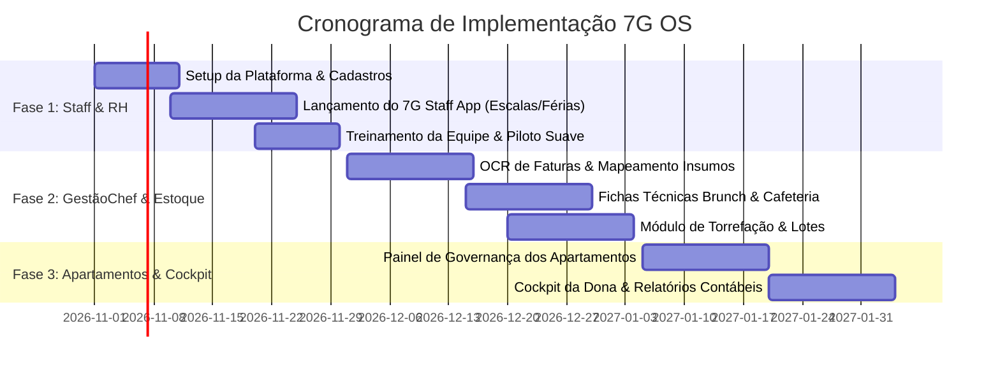

# 7G OS — O ECOSSISTEMA OPERACIONAL INTEGRADO
### Proposta Estratégica de Modernização Operacional, Gestão de Pessoal e Controle Financeiro
**Dedicado a:** Direção Geral e Proprietária do **7g Roaster** & **7g Apartments**  
**Localização:** Rua de França 52, Vila Nova de Gaia, Portugal  
**Desenvolvido por:** Equipe de Tecnologia & Operações (OneStepTo / GestãoChef)  
**Data:** Outubro de 2026 | **Versão:** 1.0 — Executiva e Confidencial  

---

## 1. RESUMO EXECUTIVO (O Pitch de 60 Segundos)

O **7g Roaster** e o **7g Apartments** construíram uma das marcas mais sólidas e respeitadas de Vila Nova de Gaia e do Norte de Portugal, unindo a excelência do café de especialidade, um brunch de alta gastronomia e uma hospitalidade premiada em alojamento local.

No entanto, o sucesso trouxe um desafio que todo negócio em rápida expansão enfrenta: **a fragmentação operacional**.
Hoje, a operação divide-se entre grupos de WhatsApp informais, escalas de turnos em planilhas ou papel, cadernos manuais de controle de férias e feriados a compensar, custos de ingredientes calculados por estimativa e relatórios que só chegam dias depois do fechamento contábil.

A proposta do **7G OS** é simples e transformadora: **reunir 100% da operação do 7G debaixo de um único teto digital proprietário**, desenvolvido sob medida para a nossa identidade e sem depender de assinaturas caras de softwares genéricos que não conversam entre si.

### O Que Entregamos:
1. **7G Staff App**: O telemóvel de cada funcionário vira a ferramenta oficial de trabalho (escalas de turnos, ponto digital com conformidade legal em Portugal, pedidos de férias em 1 clique e canal oficial de avisos, acabando de vez com o ruído no WhatsApp pessoal).
2. **GestãoChef 7G Edition**: Fichas técnicas dinâmicas para o Brunch e Cafeteria com leitura automática de faturas de fornecedores (OCR), cálculo exato de CMV (Custo das Mercadorias Vendidas) e margens de lucro em tempo real.
3. **Inventário 360° & Torrefação**: Controle da jornada completa do café (grão verde → lote torrado → sacos B2C e-commerce / revenda B2B / consumo da cafeteria / cortesias dos apartamentos).
4. **7G Apartments Hub**: Painel de governança e arrumação de quartos em tempo real, reposição de consumíveis integrada ao estoque geral e experiência personalizada para o hóspede.
5. **Cockpit Executivo da Dona**: Uma tela no seu telemóvel onde você acompanha, ao vivo, a faturação do dia, custo com mão de obra, margem de lucro e ocupação, sem precisar pedir relatórios a ninguém.

> **Impacto Estimado:** Economia imediata de **+30 horas mensais** de trabalho administrativo da gerência, redução de **3% a 5%** em desperdícios e perdas de estoque, e blindagem trabalhista total perante a legislação portuguesa.

---

## 2. O DIAGNÓSTICO: OS 5 GARGALOS INVISÍVEIS DA OPERAÇÃO ATUAL

Quando uma empresa cresce com excelência como a 7G, os custos da falta de processos integrados não aparecem de imediato no extrato bancário, mas corroem silenciosamente o tempo e o lucro:

| Área Operacional | Como Funciona Hoje (O Gargalo) | O Custo Real para a 7G |
| :--- | :--- | :--- |
| **Escalas & Comunicação** | Horários enviados em PDF ou foto no WhatsApp; avisos importantes perdidos entre conversas informais; mensagens de trabalho fora do expediente. | Risco de esquecimentos, atrasos nos turnos de pico, insatisfação da equipe e risco de quebra de regras de desconexão profissional. |
| **Férias e Feriados Compensatórios** | Apontamentos em caderno manual ou planilhas isoladas (ex: "Saldo Caderno Julho", compensação do 15 de Agosto trabalhado, dias ganhos x gozados). | Horas da liderança calculando saldos na ponta do lápis; desfalques na cozinha ou balcão por sobreposição de folgas; vulnerabilidade em inspeções da ACT. |
| **Controle de CMV & Faturas** | Faturas da Makro, Recheio e distribuidores guardadas em pastas físicas; os preços dos ovos, leite vegetal ou grão sobem, mas a ficha técnica continua com o preço antigo. | Margem de lucro esmagada sem a direção perceber; pratos que parecem lucrativos podem estar dando prejuízo operacional. |
| **Torrefação vs. Consumo** | O café verde é torrado, mas o destino dos lotes (venda no site, pacotes de 250g no balcão, uso no espresso bar e amenities nos quartos) não é baixado de forma unificada. | Divergência de estoque, perda de rastreabilidade de lotes e dificuldade de planejar compras internacionais de sacas verdes. |
| **Visão da Proprietária** | Para saber o lucro real do mês, é necessário esperar o balancete da contabilidade semanas depois. | Decisões estratégicas tomadas com base no retrovisor, e não no painel de bordo em tempo real. |

---

## 3. A SOLUÇÃO: OS 4 MÓDULOS DO ECOSSISTEMA 7G OS

O **7G OS** foi concebido não como um software engessado de prateleira, mas como um ecossistema moldado exatamente para as rotinas do 7g Roaster e dos 7g Apartments.

```
       ┌─────────────────────────────────────────────────────────────┐
       │             7G OS — COCKPIT DA PROPRIETÁRIA                │
       │    Faturação Consolidada · Margens · Ocupação · Pessoal     │
       └──────────────────────────────┬──────────────────────────────┘
                                      │
         ┌────────────────────────────┼────────────────────────────┐
         ▼                            ▼                            ▼
┌──────────────────┐        ┌──────────────────┐        ┌──────────────────┐
│  7G STAFF & TEAM │        │   GESTÃOCHEF &   │        │  7G APARTMENTS   │
│  (RH & Escalas)  │        │    INVENTÁRIO    │        │       HUB        │
├──────────────────┤        ├──────────────────┤        ├──────────────────┤
│• Escalas Semanais│        │• OCR de Faturas  │        │• Status Limpeza  │
│• Ponto Digital   │        │• Fichas Técnicas │        │• Reposição 7G    │
│• Saldo de Férias │        │• CMV em Tempo Real│       │• Kits Hóspedes   │
│• Mural Oficial   │        │• Rastreio Torra  │        │• Vouchers Café   │
└──────────────────┘        └──────────────────┘        └──────────────────┘
```

---

### MÓDULO 1: 7G STAFF APP (Comunicação, Escalas e RH)
*O aplicativo oficial no telemóvel de cada barista, cozinheiro e colaborador da governança.*

* **Escalas de Turno no Bolso:** Cada colaborador consulta seu horário semanal atualizado em tempo real. Trocas de turno só acontecem com consentimento mútuo e aprovação da gerência em 1 toque.
* **Ponto Digital com Conformidade Legal:** Registo de entrada, saída e pausas com validação por geolocalização ou rede Wi-Fi da 7G (em estrito cumprimento do Código do Trabalho português para fiscalização da ACT).
* **Gestão Automatizada de Férias e Feriados:**
  - Substituição definitiva do "caderno de papel".
  - O sistema calcula automaticamente os dias ganhos no ano, dias gozados e feriados trabalhados a compensar (ex: folga compensatória do feriado de 15 de Agosto).
  - O funcionário submete o pedido pelo app; a gerência vê o impacto no calendário geral (evitando que dois baristas seniores fiquem de férias no mesmo fim de semana) e aprova instantaneamente.
* **Mural de Comunicados e Procedimentos (SOPs):**
  - Comunicados operacionais oficiais com confirmação de leitura ("Aviso: novo lote de café da Etiópia disponível para calibração").
  - Acesso aos manuais de serviço: receitas padrão, regras de abertura e fecho da cafeteria e checklist de higienização.

---

### MÓDULO 2: GESTÃOCHEF 7G EDITION (Engenharia de Custos, Faturas & CMV)
*O cérebro financeiro da cozinha e do balcão de café.*

* **Leitura Automática de Faturas (OCR Inteligente):**
  - Basta fotografar ou subir o PDF da fatura do fornecedor (Makro, fornecedores de hortifrúti, laticínios, embalagens).
  - O sistema extrai os itens, quantidades e valores em segundos, atualizando o custo unitário dos ingredientes no banco de dados.
* **Fichas Técnicas Vivas (Brunch & Barista):**
  - Cada receita (ex: *Brunch Bowl, Tosta de Salmão, Flat White de Origem Única, Cold Brew*) tem seu custo real recalculado a cada nova compra.
  - Alerta imediato se a margem de contribuição de um prato cair abaixo da meta estabelecida.
* **Análise de Lucratividade:**
  - Identificação clara dos pratos "Estrela" (alta margem e alta venda) e dos pratos que geram prejuízo disfarçado, permitindo ajustes no cardápio com precisão cirúrgica.

---

### MÓDULO 3: INVENTÁRIO 360° & RASTREAMENTO DA TORREFAÇÃO
*Controle absoluto da saca verde até a chávena do cliente.*

* **Jornada do Café Integrada:**
  - Entrada de Sacas Verdes (origem, produtor, altitude, custo por kg).
  - Registo de Lotes de Torra (peso verde inserido, curva de torra, peso torrado final, cálculo exato da quebra/perda de massa).
  - Distribuição Inteligente do Lote:
    * X kg para pacotes de 250g / 1kg (Loja online e revenda B2B).
    * Y kg para os moinhos da cafeteria (consumo interno).
    * Z kg para cápsulas e kits de boas-vindas dos hóspedes do 7g Apartments.
* **Baixa Automática e Alerta de Ruptura:**
  - Sempre que a cafeteria vende cafés ou a governança consome pacotes para os quartos, o estoque atualiza.
  - Alertas no telemóvel do responsável: *"Estoque de Leite de Aveia abaixo do mínimo — encomendar até quinta-feira para o fim de semana"*.

---

### MÓDULO 4: 7G APARTMENTS HUB (Governança & Experiência do Hóspede)
*Sincronização perfeita entre hospitalidade e cafeteria.*

* **Painel da Governança (Housekeeping):**
  - Tela simplificada no tablet/telemóvel da equipe de limpeza: apartamentos em status *Livre*, *Ocupado*, *Aguardando Limpeza*, *Limpo & Inspecionado* ou *Em Manutenção*.
  - Elimina chamadas e mensagens no WhatsApp entre recepção e camareiras.
* **Reposição Automática de Amenities:**
  - Ao finalizar a arrumação, a camareira valida a reposição de café 7g, água e amenidades com um toque, debitando diretamente do inventário central.
* **Sinergia Café + Alojamento:**
  - Controle de vouchers de desconto para brunch e workshops de café incluídos nas reservas diretas, aumentando o faturamento médio por hóspede (*cross-selling*).

---

### COCKPIT EXECUTIVO DA PROPRIETÁRIA (A Torre de Controle)
*A tranquilidade de ter a empresa inteira na palma da mão.*

No telemóvel da dona, acessível de qualquer lugar do mundo:
1. **Faturação Consolidada:** Total do dia dividido por Cafeteria, Venda de Café/Torra e Alojamento Local.
2. **Termômetro de CMV:** Percentual de custo de mercadoria em relação à venda do dia.
3. **Custo de Pessoal (Labor Cost):** Custo de staff em tempo real e horas trabalhadas vs. orçadas.
4. **Fechamento para a Contabilidade:** Em um clique, relatórios organizados de despesas e faturas prontos para envio ao contabilista, sem pastas cheias de papéis amassados.

---

## 4. CASOS DE USO REAIS: O DIA A DIA NO 7G COM O NOVO SISTEMA

Para visualizar o impacto concreto, vejamos 4 situações comuns que acontecem todas as semanas:

### Exemplo 1: O Pedido de Férias e Escala da Cozinha
* **Cenário Atual:** A cozinheira Carla quer marcar férias de 01 a 21 de setembro. Ela avisa verbalmente ou manda no WhatsApp. O gerente precisa abrir o caderno antigo, conferir quantos dias de férias ela acumulou, checar se ela trabalhou no feriado de 15 de agosto para compensar, e conferir na cabeça se o Sazzad ou o Rabin não estarão de folga no mesmo período. Horas perdidas e risco de erro.
* **Com o 7G OS:** A Carla abre o 7G Staff App no telemóvel e clica em "Solicitar Férias". O app mostra instantaneamente o saldo dela: *22 dias disponíveis + 1 dia de feriado a compensar*. Ela seleciona as datas. A gerência recebe uma notificação com a visualização do calendário da cozinha (confirmando que há cobertura necessária) e clica em **"Aprovar"**. O saldo da Carla é atualizado automaticamente, a escala mensal bloqueia as datas e o recibo digital fica arquivado para qualquer fiscalização.

### Exemplo 2: O Leite Vegetal e o Custo do Flat White
* **Cenário Atual:** O fornecedor de leite de aveia e amêndoa aumenta o preço em 12%. A fatura chega, é assinada e vai para a contabilidade. Ninguém atualiza a ficha técnica do café. A 7G vende centenas de Flat Whites achando que tem 75% de margem, mas a margem caiu para 61%.
* **Com o 7G OS:** A fatura do fornecedor é fotografada no GestãoChef. O sistema identifica o reajuste do leite, atualiza o custo unitário e avisa: *"O custo do ingrediente 'Leite de Aveia' aumentou 12%. A margem do Flat White agora é 61%. Deseja recalcular o preço sugerido ou manter?"*. A direção tem o poder de decidir imediatamente com dados reais.

### Exemplo 3: A Arrumação do Apartamento 4
* **Cenário Atual:** O hóspede do Apartamento 4 faz check-out às 11h. A recepção manda mensagem no WhatsApp para a governança. No meio da correria do almoço da cafeteria, a mensagem passa batida. Às 14h30, o novo hóspede chega e o quarto ainda não foi liberado.
* **Com o 7G OS:** Às 11h, o check-out é acionado no sistema. O painel da governança atualiza automaticamente para *"Apartamento 4: Aguardando Limpeza (Check-in previsto: 15h)"*. A camareira inicia a arrumação, dá baixa em 4 cápsulas 7G e 2 garrafas de água no inventário e marca como *"Inspecionado"*. A recepção e a dona veem em verde no telemóvel que o quarto está impecável.

### Exemplo 4: O Fecho do Fim de Semana
* **Cenário Atual:** Domingo à noite. Para entender se o fim de semana foi lucrativo, é preciso esperar os dados do POS, a contagem de clientes dos apartamentos e as compras de emergência feitas na sexta-feira.
* **Com o 7G OS:** Domingo às 20h, a proprietária abre o Cockpit Executivo no telemóvel: vê a faturação exata da cafeteria, o volume de café moído e vendido em grão, a taxa de ocupação de 100% dos apartamentos e o CMV consolidado do fim de semana. Zero ansiedade, total previsibilidade.

---

## 5. RETORNO SOBRE O INVESTIMENTO (ROI)

Quanto custa não modernizar versus o retorno do 7G OS?

```
┌────────────────────────────────────────────────────────────────────────┐
│                   ECONOMIA ESTIMADA POR ANO NA 7G                      │
├────────────────────────────────────────────────────┬───────────────────┤
│ Redução de tempo gerencial (30h/mês @ 15€/h)       │    5.400 € / ano  │
│ Controle de CMV & Redução de Desperdício (3% em F&B)│    4.800 € / ano  │
│ Eliminação de assinaturas de softwares avulsos     │    1.800 € / ano  │
│ Prevenção de multas laborais e horas extras erradas│    3.000 € / ano  │
├────────────────────────────────────────────────────┼───────────────────┤
│ VALOR TOTAL GERADO EM EFICIÊNCIA E ECONOMIA:       │  +15.000 € / ano  │
└────────────────────────────────────────────────────┴───────────────────┘
```

### Os 4 Grandes Ativos Estratégicos para a Proprietária:
1. **Paz de Espírito:** Acabar com o fluxo incessante de mensagens de rotina no WhatsApp pessoal fora do horário.
2. **Eficiência e Cultura de Time:** Equipe engajada, sabendo suas escalas com antecedência e sentindo que trabalha em uma empresa de ponta.
3. **Independência Tecnológica:** O software é desenvolvido internamente, adaptado à realidade da 7G, sem risco de cancelamento de planos ou aumentos abusivos de fornecedores estrangeiros.
4. **Valor de Marca (Valuation):** Um negócio de restauração e alojamento que possui tecnologia e processos próprios vale substancialmente mais no mercado do que um negócio desorganizado.

---

## 6. CRONOGRAMA DE IMPLEMENTAÇÃO EM 3 FASES (Piloto Suave)

Para garantir que a operação nunca seja interrompida, propomos um roteiro modular em que cada etapa traz benefícios imediatos (*quick wins*):



* **Fase 1 (Semanas 1 a 4) — O Alívio Imediato da Gestão:**
  - Implantação do **7G Staff App**.
  - Migração de todos os dados de funcionários e histórico de férias/feriados.
  - Publicação das escalas da semana diretamente no telemóvel da equipe.
* **Fase 2 (Semanas 5 a 8) — O Controle do Dinheiro:**
  - Ativação do **GestãoChef 7G Edition**.
  - Entrada do OCR de faturas e estruturação das fichas técnicas do menu de brunch e cafés.
  - Sincronização do estoque de café verde e café torrado.
* **Fase 3 (Semanas 9 a 12) — A Integração Completa:**
  - Painel de Housekeeping dos 7 apartamentos.
  - Entrega do Cockpit Executivo no telemóvel da dona.
  - Alinhamento de relatórios de exportação com a assessoria contábil.

---

## 7. PROPOSTA DE PRÓXIMOS PASSOS (Sem Risco para a 7G)

Não é necessário tomar uma decisão definitiva hoje para toda a empresa. Propomos um início consciente e transparente:

> **A Proposta:**  
> Iniciar um **Piloto de 30 Dias da Fase 1 (7G Staff App)** exclusivamente com a equipe da cozinha e baristas.  
> Se em 30 dias a gestão de escalas e férias não se tornar pelo menos **50% mais rápida e organizada**, encerramos o processo sem qualquer fricção ou custo fixo acumulado.

---

## 8. GUIA DE APRESENTAÇÃO: COMO CONVERSAR COM A DONA

*(Roteiro estratégico para o desenvolvedor conduzir a reunião presencial)*

### 1. Abertura Empática (Criando Conexão):
> *"O 7G atingiu um nível de produto, estética e café que é referência em Gaia e no Porto. Mas sei o quanto você e os gerentes dedicam horas de vida apagando incêndios invisíveis: é escala que muda no WhatsApp, funcionário perguntando saldo de férias, planilha de feriado para compensar, e compras de fornecedores que oscilam de preço. Eu tenho uma proposta para resolver isso de forma elegante, moderna e definitiva."*

### 2. Demonstração Visual (Abra o Pitch Deck Interativo no Tablet/Telemóvel):
> *"Não vim falar de teorias de computador. Quero te mostrar funcionando na prática. Olha como fica o celular de um barista para ver a escala e pedir férias, e olha como fica a sua tela no domingo à noite com o controle de tudo."*

### 3. Respostas para Possíveis Dúvidas da Proprietária:
* **Objeção:** *"A equipe vai ter dificuldade de mexer em aplicativo?"*
  * **Resposta:** *"O app foi desenhado para ser mais fácil do que o Instagram ou WhatsApp. São botões grandes, claros e em português. No primeiro dia, o barista já abre para ver que horas entra amanhã. É intuitivo e sem complicação."*
* **Objeção:** *"Vai exigir muito do meu tempo agora?"*
  * **Resposta:** *"Pelo contrário. O desenvolvimento e a alimentação dos cadastros serão feitos por mim. O seu papel é apenas usar e usufruir da economia de tempo que isso vai te devolver a cada semana."*
* **Objeção:** *"Por que criar o nosso em vez de contratar um software pronto da internet?"*
  * **Resposta:** *"Softwares genéricos cobram mensalidades caras em euro por cada funcionário, não conversam entre cafeteria, torra e apartamentos, e você fica refém das regras deles. O 7G OS é um patrimônio da 7G, feito sob medida para a nossa rotina e sem mensalidades abusivas para terceiros."*

---
*Documento elaborado para a direção do 7g Roaster & 7g Apartments. Todos os direitos reservados.*
